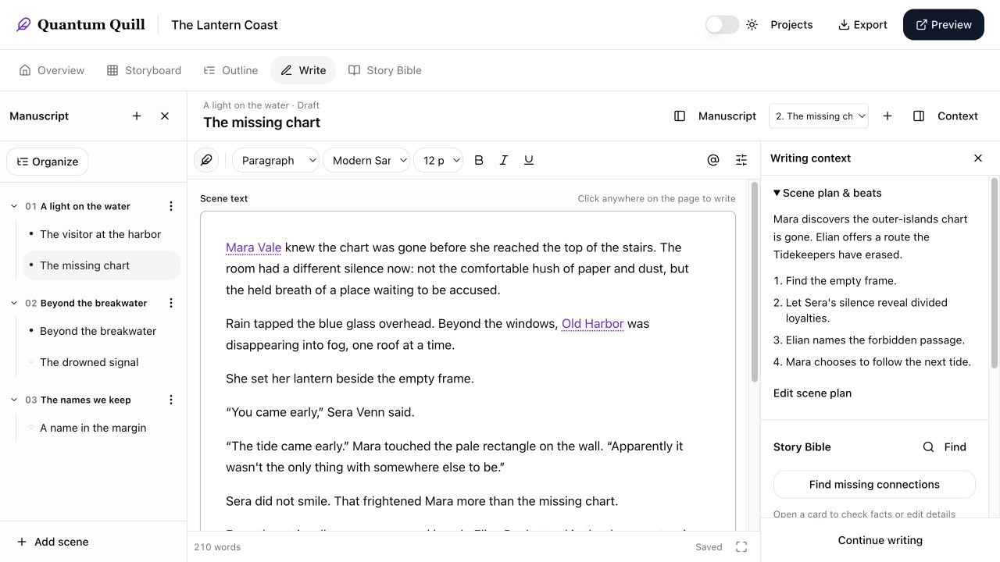
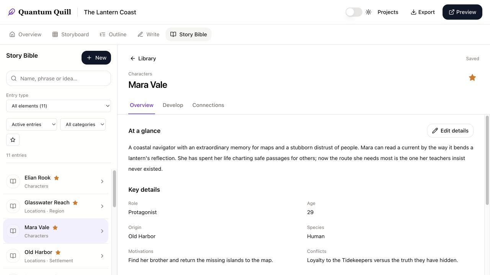
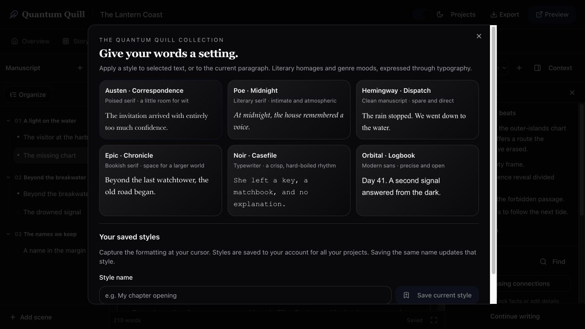

# Quantum Quill

### A world beside your writing.

Quantum Quill brings your manuscript, scene plans, characters, places, and research into one writing workspace. It is being built for novelists first: enough structure to keep a complex story coherent, with room to skip the planning and simply write.

[Explore the roadmap](https://drsurfbum.github.io/quantum-quill-roadmap/) · [Report feedback](https://github.com/drsurfbum/quantum-quill-roadmap/issues)

**Status: open alpha.** [Try Quantum Quill](https://quantquill.io). New testers can register an account; existing alpha accounts work at this address. Local installations do not sync automatically. Screenshots below use a fictional demonstration project, *The Lantern Coast*. The roadmap and design study remain separate previews.

## Plan as much—or as little—as you need

**Storyboard plot points → Outline scenes → Scene story beats → Write prose**

Start with a guided New Project Wizard, choose a plot structure, and use the Blueprint Wizard to turn selected plot points into planned chapters and scenes. Add scene summaries and beats in the Outline, then move into prose. You can also start directly with a chapter or scene and plan later. Chapter-level drafts stay intact when you introduce scenes.

## Keep your world in the writing room

The Story Bible holds seven kinds of entries: **Characters, Groups & Races, Locations, Events, World Elements, Details, and Research**. Guided sections, relationships, backlinks, search, tags, and project images help turn a collection of notes into a usable reference.

Connect entries to a scene as its viewpoint character, cast, location, or reference material. Link an element inline in the prose and open its card beside the editor to check facts or edit notes without navigating away. The connection scanner finds mentions of **existing** entries and lets you review suggestions before adding links; it does not rewrite your prose or invent new characters.

## Write comfortably, keep control of your work

- Rich formatting: fonts, sizes, headings, lists, colors, alignment, images, tables, find/replace, and more.
- Quill styles inspired by literary moods, plus reusable custom styles saved to your account.
- Chapter and scene organization, a focus view, and light/dark themes.
- Autosave with server revisions, explicit conflict review, and account/project-scoped local draft recovery. Failed saves stay recoverable; recovery offers restore/discard choices.
- Export **Word, EPUB, HTML, plain text, or JSON**. Preview supports browser printing and Save as PDF.

Draft recovery is a safety net, not a complete offline application or a substitute for exports. Browser storage can be cleared; keep copies of important writing outside the alpha.

## Help test the alpha

[Open the alpha](https://quantquill.io), choose **Register**, and create an account. Begin with a sample story:

1. Create a project and add a character and a location to its Story Bible.
2. Plan a scene—or go straight to Write—and draft a few paragraphs.
3. Link an element inline, open its card, and try the connection scanner.
4. Change formatting, switch scenes, reload, and check that the writing remains as expected.
5. Export a copy and tell us what felt useful, confusing, or missing.

Use **Feedback** inside QQ to send a private bug report, confusing experience, or idea. Your account’s recent reports show receipt numbers and review status. Browser details and email follow-up are optional; manuscript text is never attached automatically. You can also [report public feedback](https://github.com/drsurfbum/quantum-quill-roadmap/issues). Include the steps you took and what you expected. Public issues are visible to everyone: use sample text and redact account details in screenshots. Report possible security or account-access problems privately to the maintainer through your tester contact channel, rather than posting sensitive details publicly.

**Alpha boundaries:** desktop/tablet layouts are the main focus. Email verification, password-reset email, and self-service account deletion are not yet available. Collaboration, AI generation, graph/timeline views, and the legacy whiteboard are not active features. Other storytelling formats—RPG campaigns, scripts, plays, and historical narratives—are future directions, not current promises.

## About this repository

This is Quantum Quill’s public introduction, feature roadmap, and feedback space. The application source is kept in a separate private repository; this repository does not contain manuscripts, accounts, or an installable copy of the app.

The roadmap distinguishes working features, partial work, planned improvements, and later ideas. It is a living plan, not a promise of delivery dates. We are also preserving the project’s long development history for a future retrospective.

## Maintain the roadmap

Edit `roadmap.json`, then run `python3 build.py`. Review and commit the source, generated `ROADMAP.md`, and `docs/index.html` together. GitHub Pages publishes `/docs` from `main`; `dist/index.html` is an ignored local preview.

- `roadmap.json`: reviewed feature data and stable feature IDs.
- `template.html`: search, filters, direct feature links, expandable details, and print styling.
- `build.py`: generator and validation, with a restrictive Content Security Policy.
- `media/`: app screenshots from a synthetic demonstration story.

No external fonts, analytics, API requests, or runtime services are needed by the roadmap. Completed app features are checked and pushed to their feature branches; merging and deployment remain separate. Keep private writing, imports, backups, and credentials out of this repository.
